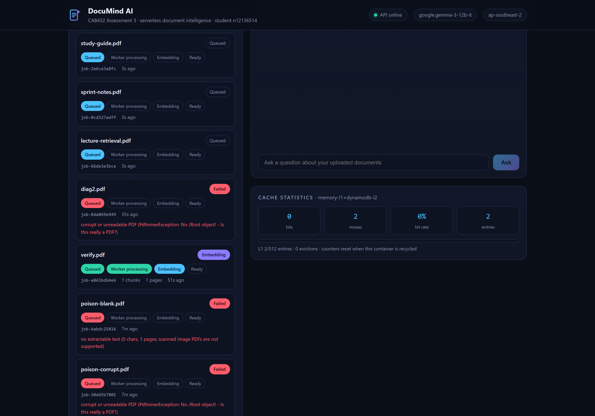
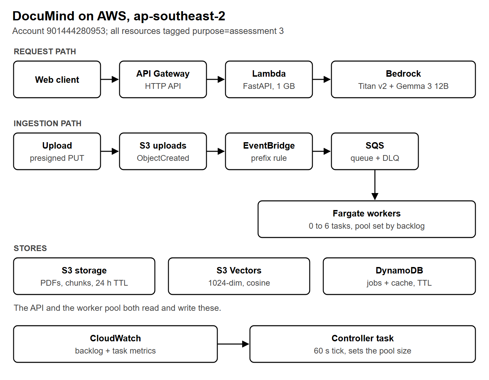
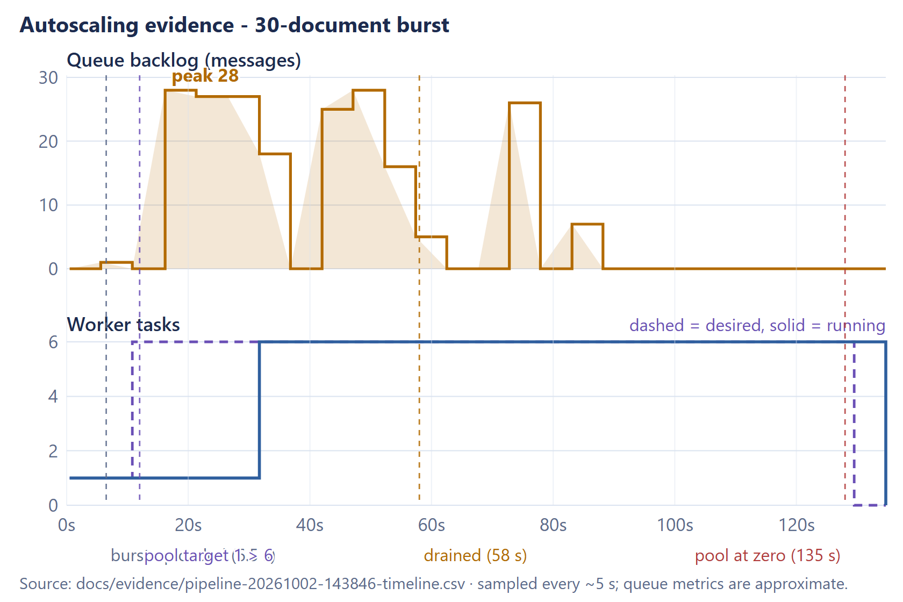
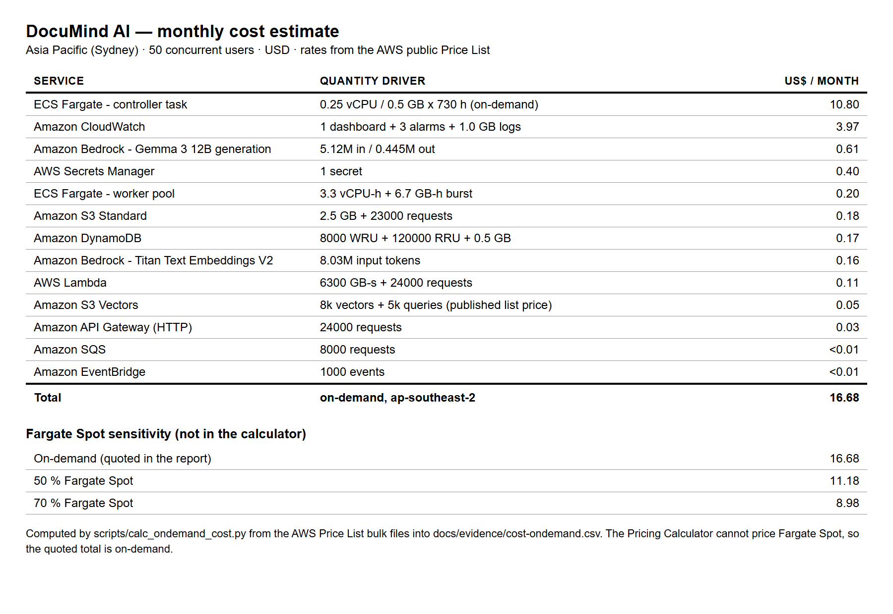
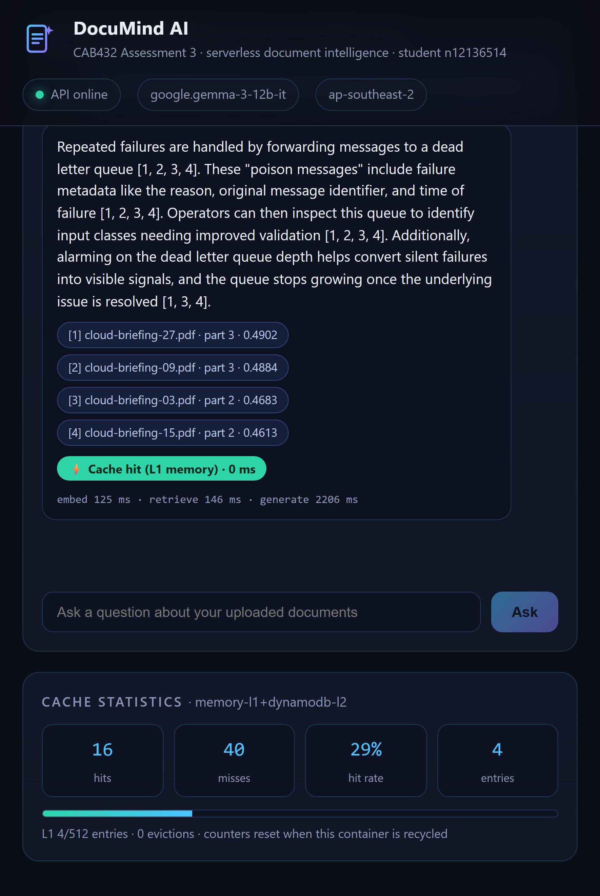

# DocuMind AI

**Upload PDFs, ask questions, get answers with citations.** An event-driven document intelligence service built on AWS, designed to cost nothing when idle and to absorb bursts without falling over.

Built for CAB432 (Cloud Application Development) at QUT. This repository is the archived record of the build: source, report, architecture diagrams and measured evidence.



---

## Why it exists

Reading a stack of PDFs is slow, and searching them is worse. Keyword search misses paraphrase, and most "chat with your documents" tools are either expensive or hostile to your data.

DocuMind takes a narrow slice of that problem. You drag in PDFs, watch them process, then ask questions in plain language. Every answer cites the passages it used. Everything expires after 24 hours, so the service suits material that should not sit on a server indefinitely.

The workload is bursty: a study group dumps a semester of readings at midnight, then nothing for hours. That shape drives the whole architecture.

## Architecture



Two independent paths share one set of managed services.

**Ingestion** is asynchronous and queue driven:

```
Browser --presigned PUT--> S3 --ObjectCreated--> EventBridge --> SQS --> Fargate workers
                                                                          |
                                                    extract -> chunk -> embed -> summarise
                                                                          |
                                                     S3 artifacts + S3 Vectors + DynamoDB
```

**Query** is stateless and cached:

```
Client --> API Gateway --> Lambda (FastAPI) --> L1 in-process cache
                                            --> L2 shared cache
                                            --> embed -> vector search -> filter -> generate
```

A controller task reads queue backlog every 60 seconds and sets the worker count:

```python
desired = 0 if backlog == 0 else clamp(ceil(backlog / 2), 1, 6)
```

The pool scales to zero. There is no always-on processing tier.

## Measured results

These numbers come from instrumented runs against the deployed system, not estimates.

| What | Result |
|---|---|
| Burst absorption | 30 documents, peak backlog 28 messages, pool 1 to 6 workers in one 60 s tick |
| Scale to zero | pool back to 0 in 1.3 minutes after the last completion |
| Cache, origin path | p50 2 408 ms, p95 3 339 ms, p99 3 419 ms server side |
| Cache, hit | 0 ms at L1, 46 ms median round trip over the network |
| Cache hit rate in test | 112 requests counted, 50 of 50 repeats served from L1 |
| Fault isolation | password protected, corrupt and blank PDFs to the dead-letter queue, no worker restarts |
| Functional checklist | 14 of 14 checks passed |
| Unit tests | 8 of 8, no AWS required |



## Cost

Modelled at 50 concurrent users, 1 000 documents and 3 000 questions a month, using AWS public price-list rates for `ap-southeast-2`.

| | US$ / month |
|---|---|
| On-demand total | **16.68** |
| Fixed floor (controller, dashboard, alarms, secret) | 14.50 |
| Variable share | 2.18 |
| With 70 % Fargate Spot | 8.98 |

Two numbers matter more than the total.

**US$0.00075 marginal cost per document.** That is worker compute, embedding and summary generation for one file. The bursty work is the cheapest part of the system, which is exactly why it belongs behind a queue.

**Ten times the demand costs US$36.26.** The fixed floor does not move, so cost per document falls from US$0.0167 to US$0.0036 and the fixed share drops from 87 % to 40 %.



## Cache behaviour

Repeated questions against the same corpus are the dominant interaction pattern, so caching is a core function rather than an optimisation.



Tier 1 lives in process, so a hit costs microseconds. Tier 2 is a shared row, so a hit anywhere in the fleet serves every instance. Each response reports which tier answered (`X-Cache: HIT-L1`, `HIT-L2`, `MISS`) and how long it took, so the behaviour is visible per request rather than only in aggregate.

## Engineering decisions worth reading

**Worker pull, not dispatcher push.** Workers long-poll the queue. No dispatcher, no worker address registry, no health checks. Backpressure is implicit: a worker cannot be handed more concurrent messages than it asked for. Failure recovery falls out of the visibility timeout, because a message whose worker died becomes visible again.

**The control law is implemented rather than delegated.** The account's target-tracking scaling APIs were not callable, so scaling runs as a small long-lived task reading queue depth. That turned out better than the managed option: every scaling decision appears as one line in the logs, so the evidence is directly auditable.

**Cache written before the response.** If the reply is lost to a timeout, the retry is served from cache in single digit milliseconds.

**Retrieval filters against live metadata.** One batch read drops chunks whose documents have expired or failed. This is what makes the 24 hour TTL safe: an expired document cannot be cited even before its vectors are reaped.

**Thin queue messages.** The message carries a pointer (`jobId`, bucket, key) and never a payload, so the queue cannot become a shadow database.

**Delete means delete.** Removing a document clears its vectors, its S3 artifacts, its job row and the answer cache, then reports what it removed.

## AWS services used

| Layer | Service |
|---|---|
| Ingress | API Gateway (HTTP API), Lambda function URL as a fallback |
| Query API | Lambda, Python 3.12, FastAPI via Mangum |
| Ingestion | ECS Fargate Spot, 0 to 6 tasks, worker and controller |
| Queueing | SQS with a dead-letter queue |
| Events | S3 event notifications routed through EventBridge |
| Storage | S3 for uploads, extracted text and summaries, S3 Vectors for embeddings |
| Metadata and cache | DynamoDB, single table, TTL on every row |
| AI | Amazon Bedrock: Titan Text Embeddings V2 and Gemma 3 12B |
| Operations | CloudWatch logs, dashboard and three alarms |
| Secrets | Secrets Manager for the admin key |
| Images | ECR |

Fifteen of the sixteen cloud pattern categories are implemented outright. The sixteenth, edge caching, is designed and documented but not deployed.

## Getting started

The application code is self-contained in `backend/` and `frontend/`.

```bash
# worker unit tests: no AWS needed
cd backend/worker && python test_local.py

# frontend
cd frontend
npm install
npm run dev
```

Run the API locally with the dependencies in `backend/api/requirements.txt`. The service reads its configuration from environment variables (bucket, table, queue, model IDs, admin key), so a local run against real AWS needs credentials and provisioned resources. The infrastructure was declared in `submission-a3-infra.yml` and deployed into a course account.

## Repository layout

```
backend/
  api/        FastAPI service: presign, jobs, query, MCP, cache, static hosting
  worker/     SQS worker: extract, chunk, embed, summarise, store, plus unit tests
  scaler/     controller task implementing the control law
  Dockerfile  worker and controller image
frontend/     React 18 + Vite SPA: dropzone, pipeline monitor, cited chat
docs/
  figures/    architecture, sequence and UI figures used in the report
  diagrams/   SVG sources
  evidence/   measurements behind the numbers above
REPORT.md                    full write-up
DocuMind-A3-Report.pdf       formatted report
submission-a3-infra.yml      infrastructure declaration
```

## Project status

**The deployment is temporary by design.** It lives in a university teaching account that gets retired at the end of semester, so its URLs are not a permanent part of this project.

The durable part is preserved here: the source, the architecture, the measured evidence, the figures and the full report. Every screenshot and every number in this README was captured while the system was running.

## Acknowledgements

Built on AWS documentation for S3 event notifications, S3 Vectors, EventBridge, SQS, ECS Fargate, DynamoDB TTL, Bedrock and CloudWatch Embedded Metric Format.

Course material and assessment structure: CAB432, QUT.
